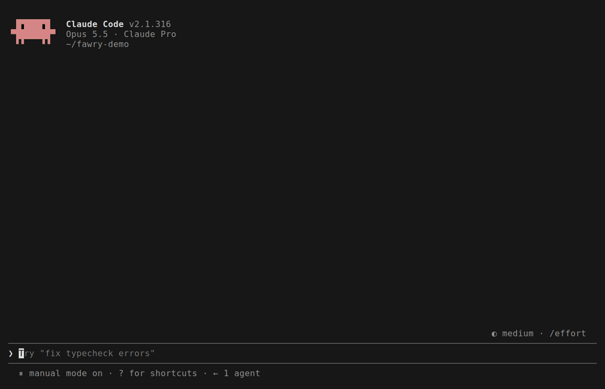
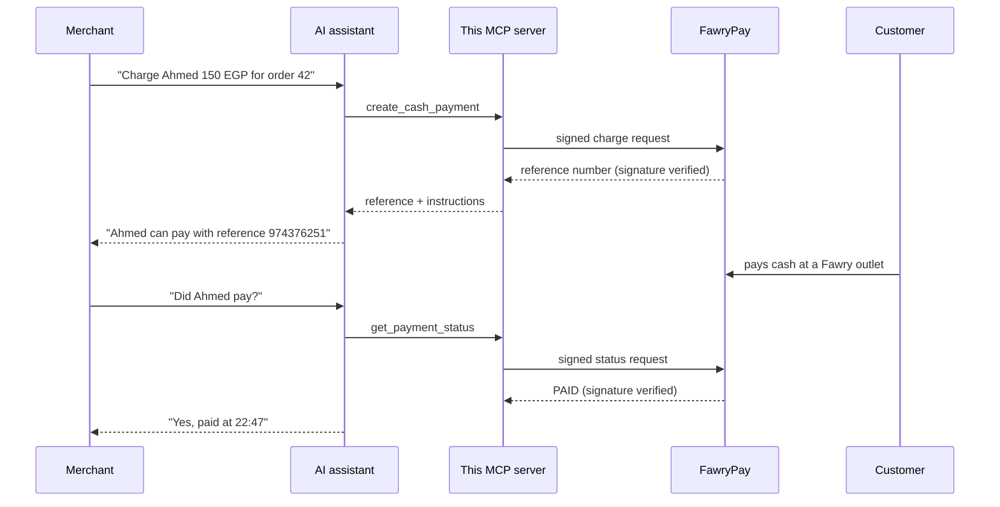

# masr-pay-mcp-unofficial

[](https://github.com/mohamedaly-cloud/masr-pay-mcp-unofficial/actions/workflows/ci.yml)

An **unofficial** [MCP](https://modelcontextprotocol.io) server that lets an AI assistant take
**cash payments in Egypt through FawryPay's Pay-at-Fawry**:

> **Merchant:** Charge Ahmed 150 EGP for order 42, he'll pay cash.
> **Assistant:** Done. Ahmed can pay 150.00 EGP at any Fawry outlet with reference **974376251**, before 3 Nov.
>
> *(Ahmed pays at a Fawry shop.)*
>
> **Merchant:** Did Ahmed pay?
> **Assistant:** Yes, order 42 is paid: 150.00 EGP received on 31 Oct at 22:47.



It's for merchants contracted **directly with FawryPay**, and for the developers and agencies who
build sales bots for them. Paymob has an official MCP server; Fawry doesn't, so this one talks to
FawryPay's own API and its network of outlets.

> **Not affiliated with, endorsed by, or supported by Fawry.** "Fawry" and "FawryPay" are used
> only to describe the API this project talks to. The server never stores credentials, customer
> data or funds.

## Try the live demo
A public copy runs on AWS against a **mock** of Fawry (fake merchant, fake money). Point any MCP
client that supports Streamable HTTP and custom headers at it:

```json
{
  "type": "http",
  "url": "https://3t8oh2vfxb.execute-api.eu-west-1.amazonaws.com/mcp",
  "headers": {
    "X-Fawry-Merchant-Code": "MOCKMERCHANT0001",
    "X-Fawry-Secure-Key": "mock-secure-key-not-a-real-fawry-key"
  }
}
```

Or use [MCP Inspector](docs/inspector.md): transport Streamable HTTP, that URL, those two headers.

Then ask your assistant to charge someone, and play the customer paying cash at an outlet:
```bash
curl -X POST https://ig7kh4i8u8.execute-api.eu-west-1.amazonaws.com/__admin/kiosk-pay/<reference_number>
```
The demo is public: use made-up names, phones and emails.

## How it works


## Why it's safe to give an AI
- **Refunds need a human.** A refund or cancellation never happens on the first call: it returns
  a preview and a short-lived token bound to the exact order and amount. The action happens only
  when the call is repeated with that token, and supporting clients ask the human directly.
  Refunds are also off by default and capped (2,000 EGP each by default).
- **Nothing is stored.** The merchant's Fawry key comes with each request and is dropped after it.
  No database, no customer data kept.
- **"Paid" is never taken on trust.** Every Fawry response with order data is signature-checked,
  and after a refund or cancel the status is fetched and checked again. Nothing is reported as
  paid on an unverified reply.
- **Every call is audited:** one JSON line per tool call, with keys, phones and emails redacted.
- **Least-privilege AWS:** deploys from GitHub without stored keys; each function can touch only
  its own logs and secret. Details in [docs/threat-model.md](docs/threat-model.md).

## Status
v0.1. Four tools, over stdio locally and over Streamable HTTP on AWS Lambda, built on the official
MCP Python SDK v2 (protocol 2026-07-28). Until FawryPay issues sandbox credentials, everything is
built and tested against our own mock of the Fawry API. What still needs Fawry's confirmation is
listed in [docs/decisions.md](docs/decisions.md#verify-list).

## Tools
| Tool | What it does | Safety |
|---|---|---|
| `create_cash_payment` | Creates a Pay-at-Fawry reference for an order (amount in EGP, customer mobile/email, expiry in hours, default 72) | |
| `get_payment_status` | Is it paid? Normalized status (`awaiting_payment`, `paid`, `expired`, …) plus Fawry's raw status | read-only |
| `cancel_unpaid_payment` | Cancels a reference before it's paid | destructive, needs confirmation, **off by default** |
| `refund_payment` | Refunds a paid order (full by default; one refund per order) | destructive, needs confirmation, **off by default**, max 2,000 EGP per refund |

**Refunds and cancellations are off unless the merchant turns them on**
(`MASR_PAY_ENABLE_DESTRUCTIVE_TOOLS=true`). Keep them off when the assistant talks to customers
(a sales bot): the person saying "yes" to a refund must be the merchant, never the customer
being refunded. Turn them on only for an assistant that the merchant or their staff use.

A destructive tool never acts on the first call. That call returns a **preview** and a
**confirmation token**, which is HMAC-signed, bound to the exact order, amount and reason, and valid
for 5 minutes. The action happens only on a second call that carries the token. The host's approval
prompt (`destructiveHint`) also applies, and when the client supports MCP elicitation the server
asks the human directly.

Also built in: one redacted JSON **audit line per tool call** (stderr), a **per-payment limit**
(default 50,000 EGP), refunds capped at the order amount, and Fawry response signatures verified
before anything is reported as paid. See [docs/threat-model.md](docs/threat-model.md).

## Run it locally
The server speaks stdio: `python -m masr_pay_mcp`, or the `masr-pay-mcp-unofficial` command. Example
host entry (the `mcpServers` format most MCP hosts use), pointed at the local mock:
```json
{
  "mcpServers": {
    "fawry-unofficial": {
      "command": "/path/to/repo/.venv/bin/masr-pay-mcp-unofficial",
      "env": {
        "FAWRY_ENV": "mock",
        "FAWRY_MERCHANT_CODE": "MOCKMERCHANT0001",
        "FAWRY_SECURE_KEY": "mock-secure-key-not-a-real-fawry-key",
        "MASR_PAY_ENABLE_DESTRUCTIVE_TOOLS": "true"
      }
    }
  }
}
```
| Env var | Meaning |
|---|---|
| `FAWRY_MERCHANT_CODE`, `FAWRY_SECURE_KEY` | Required. Read on every call, never stored. |
| `FAWRY_ENV` | `mock` (default, `http://127.0.0.1:8080`), `staging` or `production` |
| `FAWRY_BASE_URL` | Overrides the URL picked by `FAWRY_ENV` |
| `FAWRY_LOG_LEVEL` | Default `INFO`. Logs go to stderr, redacted. The audit log is always on. |
| `MASR_PAY_ENABLE_DESTRUCTIVE_TOOLS` | `true` adds `cancel_unpaid_payment` and `refund_payment`. Default off. |
| `MASR_PAY_MAX_PAYMENT_EGP` | Per-payment limit, default `50000` |
| `MASR_PAY_MAX_REFUND_EGP` | Per-refund limit, default `2000`. Larger refunds go through Fawry directly. |
| `MASR_PAY_CONFIRM_SECRET` | HMAC key for confirmation tokens, at least 32 characters. If unset, a random key per process (fine for stdio). The HTTP server requires it, or: |
| `MASR_PAY_CONFIRM_SECRET_ARN` | HTTP server only: read the key from this Secrets Manager secret (what the AWS stack does). |

See [docs/inspector.md](docs/inspector.md) to watch the raw MCP traffic.

## Run the local demo
```bash
python scripts/demo.py   # create 150 EGP for order 42 -> pay -> "paid?" -> refund preview -> confirm
```

## Hosted on AWS
```
MCP client --HTTPS--> API Gateway (HTTP API, throttled) --> Lambda: MCP server --> Fawry
                                                                              \-> mock (demo)
```
- **Endpoint:** `POST https://<api-id>.execute-api.eu-west-1.amazonaws.com/mcp` (the stack's
  `McpUrl` output), Streamable HTTP, stateless.
- **Credentials go in headers on every request:** `X-Fawry-Merchant-Code` and
  `X-Fawry-Secure-Key`. They're used for that request and never stored or logged. For the
  public demo, use the mock's fake merchant: `MOCKMERCHANT0001` /
  `mock-secure-key-not-a-real-fawry-key`.
- **The demo mock is public.** Anyone can list its orders (`GET /__admin/orders`), so never put
  real customer names, phones or emails into it. Use made-up ones, like `01012345678`.
- **Opening the MCP URL in a browser shows a "use an MCP client" message (HTTP 405).** That's
  expected: the server only talks to MCP clients, over POST.
- **Audit log:** CloudWatch log group `/masr-pay-mcp/masr-pay-mcp/mcp`, one JSON line per tool
  call, kept 30 days.
- **Cost: about $0.45 a month at demo traffic.** $0.40 of that is the Secrets Manager secret.
  Lambda stays within the free tier, and API Gateway is about $1 per million requests (eu-west-1
  prices, checked 2026-10-31).

Deploy:
```bash
# once, as an AWS admin: GitHub OIDC deploy role, CloudFormation role, permissions boundary, bucket
aws cloudformation deploy --template-file infra/ci-bootstrap.yaml \
  --stack-name masr-pay-mcp-ci --capabilities CAPABILITY_NAMED_IAM
# then every push to main deploys through GitHub Actions; or by hand:
sam build && sam deploy --role-arn <CloudFormationRoleArn> --s3-bucket <ArtifactBucketName>
python scripts/smoke_remote.py <McpUrl> <MockUrl>
```

## Run the mock
```bash
python -m mock_fawry          # http://127.0.0.1:8080, OpenAPI docs at /docs
```
| Env var | Default |
|---|---|
| `MOCK_MERCHANT_CODE` | `MOCKMERCHANT0001` |
| `MOCK_SECURE_KEY` | a built-in fake key |
| `MOCK_FAWRY_FEES` | `0` (EGP added to each order's payment amount) |
| `MOCK_HOST` / `MOCK_PORT` | `127.0.0.1` / `8080` |

Fawry endpoints (same paths as Fawry):
`POST /ECommerceWeb/Fawry/payments/charge`, `GET /ECommerceWeb/Fawry/payments/status/v2`,
`POST /ECommerceWeb/Fawry/payments/refund`, `POST /ECommerceWeb/api/orders/cancel-unpaid-order`.

Mock-only admin endpoints:
| Endpoint | Does |
|---|---|
| `POST /__admin/kiosk-pay/{referenceNumber}` | Simulates the customer paying cash at an outlet |
| `GET /__admin/orders` | Lists all orders |
| `POST /__admin/reset` | Clears all orders |

Order lifecycle in the mock: `UNPAID → PAID` (kiosk-pay), `UNPAID → EXPIRED` (after
`paymentExpiry`), `UNPAID → CANCELED`, `PAID → REFUNDED` (one refund per order).

## Develop
```bash
python3.12 -m venv .venv && . .venv/bin/activate
pip install -e ".[dev]"
pytest
ruff check . && ruff format --check .
```

## Layout
```
masr_pay_mcp/server.py                     the four MCP tools
masr_pay_mcp/web.py                        the hosted server (Streamable HTTP, for Lambda)
masr_pay_mcp/core/confirm.py               stateless HMAC confirmation tokens
masr_pay_mcp/core/audit.py                 one structured audit line per tool call
masr_pay_mcp/core/guardrails.py            payment limit, refund cap
masr_pay_mcp/core/redaction.py             keeps secrets and customer PII out of logs
masr_pay_mcp/core/provider.py              provider-neutral interface the tools use
masr_pay_mcp/providers/fawry/provider.py   FawryPay behind that interface
masr_pay_mcp/providers/fawry/client.py     signs requests, verifies responses, normalizes fields
masr_pay_mcp/providers/fawry/config.py     environment + credentials (read fresh on every call)
masr_pay_mcp/providers/fawry/signatures.py Fawry SHA-256 signature recipes, one function each
mock_fawry/                                FastAPI mock of Fawry staging (in-memory orders)
tests/                                     pytest; tests/vectors.json holds our own signature vectors
scripts/demo.py                            milestone demo over real stdio
scripts/smoke_remote.py                    the same story against the deployed stack
infra/template.yaml                        SAM: Lambda + API Gateway, secret, logs, IAM
infra/ci-bootstrap.yaml                    one-time: GitHub OIDC deploy role, boundary, bucket
.github/workflows/ci.yml                   lint, tests, pip-audit, cfn-lint; deploy on main
docs/design.md                             what it is, the rules, and the Fawry API reference
docs/decisions.md                          why things are the way they are, plus the "verify" list
docs/threat-model.md                       threats and the code that mitigates each
docs/openapi.yaml                          the four FawryPay endpoints we use, with confidence labels
docs/inspector.md                          MCP Inspector walkthrough
```

## License
[MIT](LICENSE)
